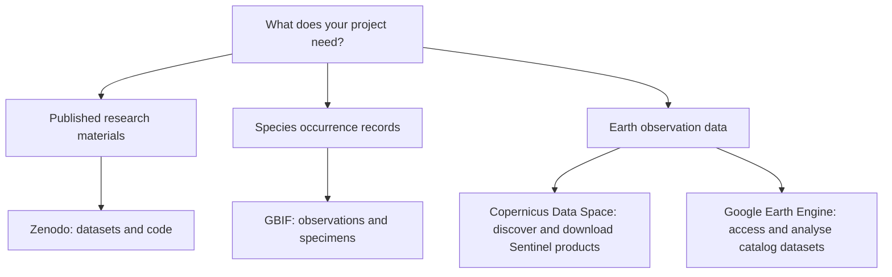
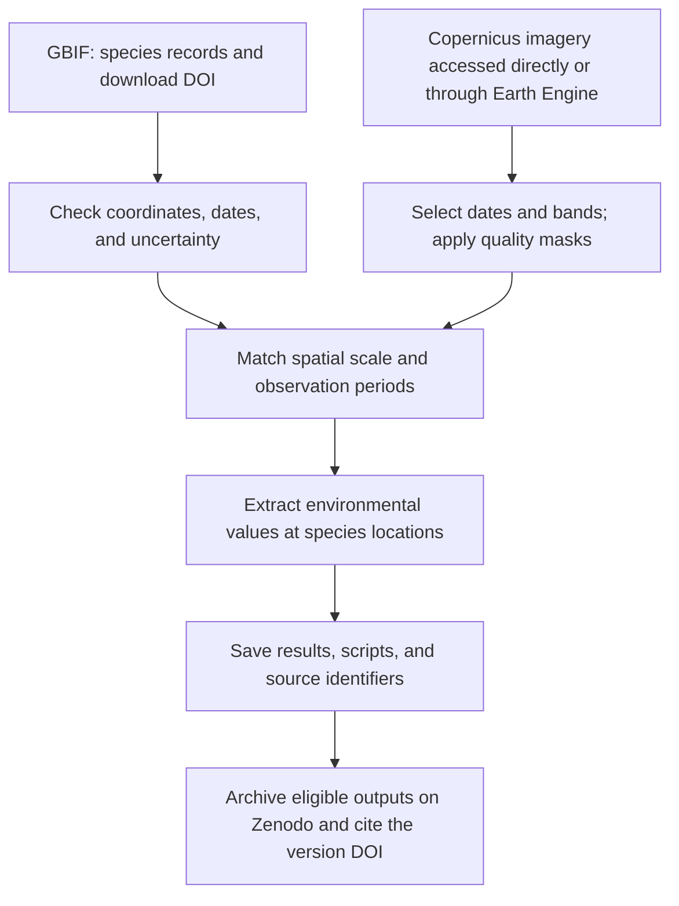

# Data availability: a guide for students

Use this guide to find research data and document the exact datasets used in your assignments, dissertation, or research project. The links below point to repositories and data platforms; add the specific dataset DOIs or product identifiers to your own data availability statement.

## Figure 1. Choose your starting point

*These services can be combined. Copernicus Sentinel data are also available through Earth Engine; record the access route and exact collection or products used.*

## Zenodo

*Zenodo links research files to a citable version. Conceptual illustration.*

[Zenodo](https://zenodo.org/) hosts research datasets, code, and other research materials.

1. Search using a topic, dataset title, author, or DOI.
2. Read the record description and check the files, licence, and version.
3. Download the files needed for your analysis and keep the accompanying documentation.
4. Copy the citation supplied by the record. For reproducibility, cite the DOI of the specific version you used.

Record the dataset title, creators, publication year, version, DOI, and licence. Access and reuse conditions depend on the individual record.

## GBIF

*GBIF connects species occurrence records to locations and dates. Conceptual illustration.*

[GBIF—the Global Biodiversity Information Facility](https://www.gbif.org/) provides access to biodiversity data contributed by many institutions. Start with the [occurrence search](https://www.gbif.org/occurrence/search) to find records of organisms observed or collected at particular places and times.

1. Select your species or taxonomic group, geographic area, and time period.
2. If you need mapped records, filter for coordinates and inspect coordinate uncertainty and geospatial issues.
3. Record your filters, then request an occurrence download through your GBIF account.
4. Save the original download, its metadata, and the citation provided by GBIF, including the download DOI.
5. Document any later cleaning, exclusions, or transformations in your analysis script.

Check for duplicates, missing values, coordinate errors, and differences in sampling effort. Occurrence records alone do not establish absence from places without records. Check the licences and attribution requirements of the contributing datasets.

## Google Earth Engine

*Earth Engine connects catalog data, analysis code, and exported results. Conceptual illustration.*

[Google Earth Engine](https://earthengine.google.com/) combines a catalog of geospatial datasets with tools for analysing them. Browse the [Earth Engine Data Catalog](https://developers.google.com/earth-engine/datasets) to find imagery, climate variables, elevation, land cover, and other environmental data.

1. Find a suitable dataset and read its catalog page, including temporal coverage, spatial resolution, bands, units, scale factors, and terms of use.
2. Follow the [access and setup instructions](https://developers.google.com/earth-engine/guides/access) before using the platform.
3. Save the exact collection or asset ID in your script, together with the study area, date range, selected bands, and filters.
4. Document cloud masking, compositing, calculations, and export settings, including coordinate reference system and pixel size.
5. Cite the original data source using its catalog guidance and acknowledge Earth Engine as the analysis platform where appropriate.

For example, the [harmonized Sentinel-2 surface reflectance collection](https://developers.google.com/earth-engine/datasets/catalog/COPERNICUS_S2_SR_HARMONIZED) has the collection ID `COPERNICUS/S2_SR_HARMONIZED`. Record the image identifiers selected for the analysis when possible, since rerunning a query against an evolving collection may produce a different selection.

## Copernicus

*Copernicus provides satellite products with acquisition and processing metadata. Conceptual illustration.*

The [Copernicus Data Space Ecosystem](https://dataspace.copernicus.eu/) provides access to Earth observation data, including the Sentinel missions. Use the [Copernicus Browser](https://browser.dataspace.copernicus.eu/) to explore imagery and inspect available products.

1. Choose the mission and product appropriate for your question: for example, Sentinel-2 optical imagery for vegetation studies or Sentinel-1 radar imagery for applications requiring radar observations.
2. Define the study area and date range, then inspect suitable acquisitions. For optical data, check clouds over your actual study area.
3. Record the product type and processing level. For example, Sentinel-2 Level-1C and Level-2A represent different stages of processing and should be distinguished in your methods.
4. Download the required products or access them through a documented service. Save the product identifiers, acquisition dates, metadata, and processing baseline where available.
5. Record preprocessing and follow the attribution and licence conditions associated with the products used.

The original satellite product and a visualization exported from a browser are different outputs. For quantitative analysis, retain the relevant bands, units, scale factors, and processing information. For other Copernicus services, identify the specific service, dataset, version, and access portal used.

## Figure 2. Connect biodiversity and satellite data

*Illustrative student workflow. Assess coordinate uncertainty, temporal mismatch, and sampling bias before interpreting relationships. Archive and redistribute data only as permitted by their source licences.*

## What to include in your submission

- The specific Zenodo record DOI and/or GBIF occurrence download DOI.
- Dataset versions and the dates you accessed or downloaded the data.
- GBIF search filters and any data-cleaning steps.
- Earth Engine collection or asset IDs, image selection, analysis code, and export settings.
- Copernicus mission, product type, processing level, product identifiers, acquisition dates, and access route.
- Scripts needed to reproduce the analysis and create derived data.
- Relevant licences and required attribution.

Keep original downloads separate from processed files so that your workflow can be reproduced.

## Example data availability statement

Replace all bracketed fields and remove any source you did not use. This is a template, not a statement that data have already been deposited.

> The data used in this study are available from Zenodo at [specific record DOI] ([creators], [year], version [version]) and from GBIF at [occurrence download DOI] (downloaded on [YYYY-MM-DD]). GBIF records were selected using [taxonomic, geographic, temporal, and other filters]. Data preparation and analysis scripts are available at [repository URL or DOI]. Data were reused under the licences specified in the source records. [Describe where any derived data are available, or explain any access restrictions.]

For a project that also uses satellite data, adapt this additional paragraph:

> Earth observation data were obtained from [Copernicus service and product] through [Copernicus Data Space Ecosystem and/or Google Earth Engine] (accessed on [YYYY-MM-DD]). We used [product identifiers and/or Earth Engine collection ID and image identifiers], covering [study area] during [date range], at processing level [level]. The scripts document [quality masking, compositing, derived variables, and export settings]. The original data are available from [dataset catalog or product URL], and derived outputs are available at [repository DOI or URL, or explanation of restrictions].

## Official guidance

- [Zenodo: sharing and citing a record](https://support.zenodo.org/help/en-gb/25-citations/234-how-to-share-or-cite-a-zenodo-record)
- [Zenodo: DOI versioning](https://support.zenodo.org/help/en-gb/1-upload-deposit/97-what-is-doi-versioning)
- [GBIF citation guidelines](https://www.gbif.org/citation-guidelines)
- [GBIF occurrence download formats](https://techdocs.gbif.org/en/data-use/download-formats)
- [Earth Engine Data Catalog](https://developers.google.com/earth-engine/datasets)
- [Earth Engine access and setup](https://developers.google.com/earth-engine/guides/access)
- [Copernicus: explore data](https://dataspace.copernicus.eu/explore-data)
- [Copernicus Browser documentation](https://documentation.dataspace.copernicus.eu/Applications/Browser.html)
