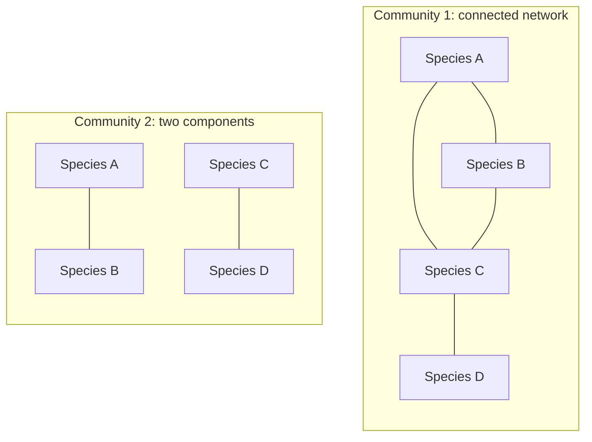
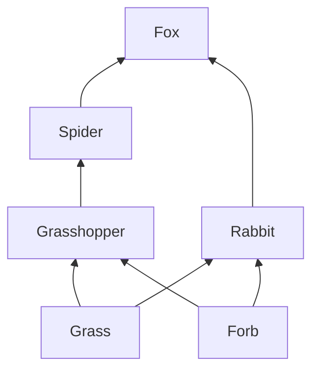
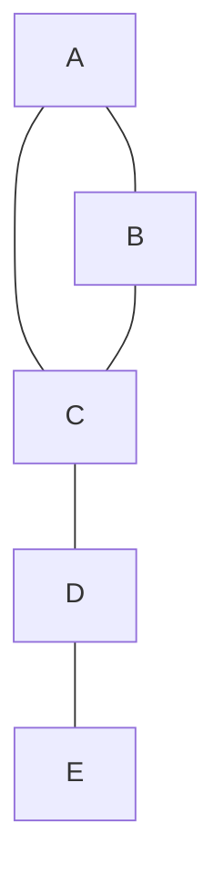
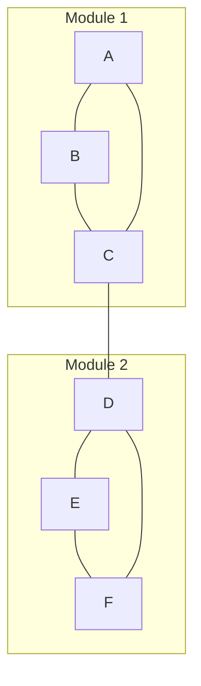
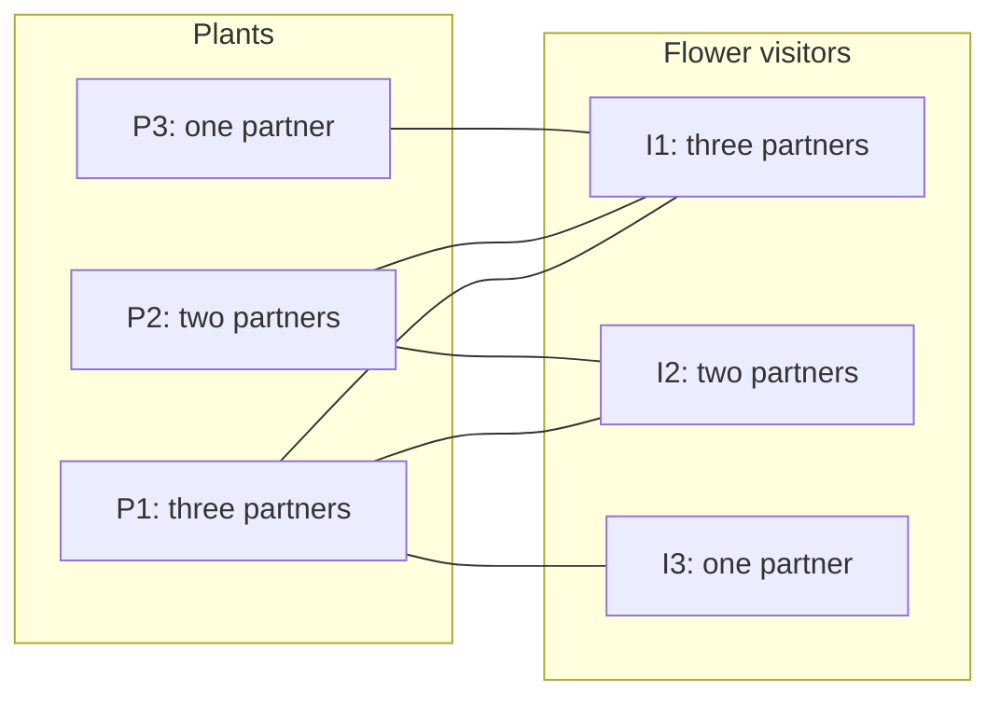
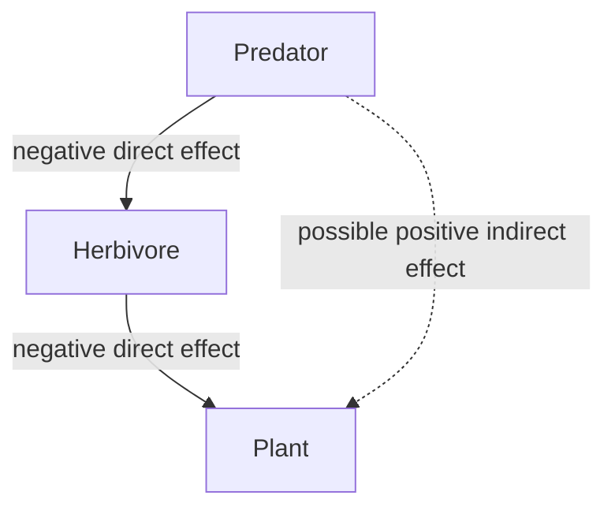
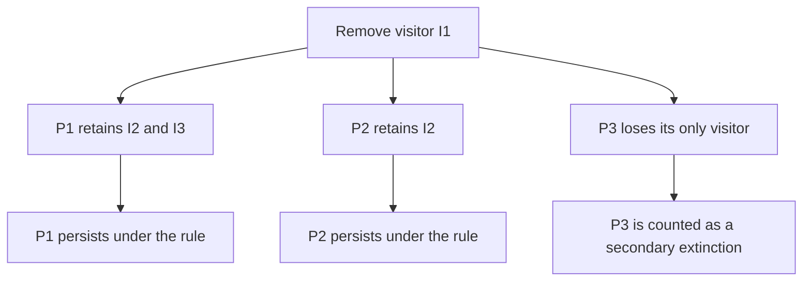

# Graph Theory in Community Ecology
## A student guide to species interactions and ecological networks

**Level:** introductory university course.  
**Background:** basic community ecology; no previous graph theory required.  
**Suggested use:** a lecture followed by a practical discussion or group exercise.

> **The central idea:** a community is more than a list of species. Its organization also depends on which species interact, how they interact, and how these interactions connect the community.

**Reading this file.** All seven figures are embedded as editable Mermaid diagrams: no separate image files or internet connection are needed once a Mermaid-capable viewer is installed. Open the file in a Markdown viewer that supports Mermaid and mathematical notation. A basic text editor will show the diagram source rather than rendered figures. All networks and numerical datasets below are simplified teaching examples, not empirical observations.

### Learning objectives

After working through this guide, you should be able to:

- Represent a community as a graph and explain the meaning of its nodes and edges.
- Distinguish directed, undirected, weighted, signed, and bipartite networks.
- Calculate degree, mean degree, and connectance using an appropriate denominator.
- Interpret centrality, modularity, and nestedness in ecological terms.
- Explain how species loss can propagate through an interaction network.
- Identify what network topology can and cannot reveal about ecological processes.

---

## 1. From a species list to a network

Imagine two meadows containing the same plant and insect species. Species richness is identical, but the communities may function differently if their interactions differ. In one meadow, each plant may receive visits from several insect species. In the other, some plants may depend on a single visitor.

Graph theory provides a language for describing these relationships. A graph is written as:

$$
G=(V,E)
$$

Here, $V$ is the set of **vertices**, usually called **nodes**, and $E$ is the set of **edges**, also called **links**. In this guide, nodes represent species and edges represent a clearly defined relationship between species.

The definition of an edge is part of the ecological hypothesis. An observed feeding event, a flower visit, and an abundance correlation are different kinds of evidence and should not be treated as interchangeable.

| Community question | Nodes | Meaning of an edge |
| :--- | :--- | :--- |
| Who eats whom? | Resource and consumer species | A feeding relationship |
| Who visits which flowers? | Plant and flower-visitor species | A recorded flower visit |
| Which species compete? | Species using shared resources | Evidence of a competitive effect |
| Which species occur together? | Species surveyed across sites | A defined statistical association |

### Figure 1. The same species can form different networks

**Interpretation.** Both networks contain four species. Only the first contains a path connecting every pair. For this example, links indicate observed pairwise interactions without displaying their direction or sign. The drawings describe interaction structure; they do not, by themselves, establish which community is more stable.

---

## 2. Choosing the right graph

### 2.1 Undirected and directed graphs

In an **undirected graph**, a link connects two nodes without specifying a direction. This can represent whether any interaction has been observed between a pair.

In a **directed graph**, each link has an origin and a destination. A food web can use arrows from resource to consumer, following the direction of energy transfer. Some datasets use the reverse convention, so always define it.

### Figure 2. A small food web

**Interpretation.** Arrows mean **resource → consumer**. Grass and the forb are basal resources. The fox receives energy through two feeding routes of different lengths. This is a hypothetical web, and its arrows do not encode positive or negative population effects.

### 2.2 Binary and weighted graphs

A **binary graph** records whether a link is present. A **weighted graph** also records a quantity associated with each link: number of visits, biomass consumed, or an estimated interaction strength, for example.

These quantities have different meanings. Ten flower visits are not necessarily ten successful pollination events, and visit frequency is not automatically a measure of a species' effect on plant reproduction.

### 2.3 Signed graphs

A **signed graph** distinguishes positive and negative effects. A predator–prey pair typically involves a positive effect of prey on predator growth and a negative effect of predator on prey growth. It therefore has two directional effects, even when a food-web diagram displays only one energy-flow arrow.

| Interaction | Effect on species 1 | Effect on species 2 |
| :--- | :---: | :---: |
| Mutualism | + | + |
| Competition | − | − |
| Predation or herbivory | + for the consumer | − for the resource |
| Commensalism | + | 0 |

The signs summarize effects under specified conditions. Their magnitude, and sometimes their sign, can change with environmental conditions or species densities.

### 2.4 Bipartite graphs

A **bipartite graph** has two sets of nodes, with links allowed only between sets. Plant–pollinator, host–parasite, and plant–herbivore networks are common examples.

This restriction describes the network being analysed. A plant–pollinator graph does not claim that plant–plant competition or insect–insect predation is absent from the actual community.

---

## 3. From the drawing to a matrix

A network can be stored as an **adjacency matrix**. For a binary graph:

$$
a_{ij}=\begin{cases}
1 & \text{if a link from node }i\text{ to node }j\text{ is recorded},\\
0 & \text{otherwise}.
\end{cases}
$$

For an undirected graph, $a_{ij}=a_{ji}$. In a directed graph, the two entries can differ. We use rows as origins and columns as destinations. We exclude self-links unless explicitly stated otherwise.

### Figure 3. A network for calculating basic metrics

Its adjacency matrix is:

| From / to | A | B | C | D | E |
| :--- | ---: | ---: | ---: | ---: | ---: |
| A | 0 | 1 | 1 | 0 | 0 |
| B | 1 | 0 | 1 | 0 | 0 |
| C | 1 | 1 | 0 | 1 | 0 |
| D | 0 | 0 | 1 | 0 | 1 |
| E | 0 | 0 | 0 | 1 | 0 |

There are **five nodes and five edges**. The matrix contains ten entries equal to one because every undirected edge appears twice.

> **Check your understanding:** why would counting all the ones as separate edges give the wrong answer here?

---

## 4. Basic network metrics

### 4.1 Degree: how many partners?

The **degree** of a node is its number of neighbours. In an undirected binary graph:

$$
k_i=\sum_j a_{ij}.
$$

For Figure 3:

| Node | Degree | Interpretation within this example |
| :--- | ---: | :--- |
| A | 2 | Connected to B and C |
| B | 2 | Connected to A and C |
| C | 3 | The most connected node |
| D | 2 | Connects E to the rest of the graph |
| E | 1 | Has only one recorded partner |

With $N$ nodes and $L$ undirected edges, the mean degree is:

$$
\bar{k}=\frac{2L}{N}=\frac{2\times5}{5}=2.
$$

For a directed graph, distinguish **in-degree** from **out-degree**. Under the resource-to-consumer convention, in-degree counts resource species and out-degree counts consumer species.

In a weighted network, **strength** is the sum of incident weights. Degree and strength answer different questions: a species can have many partners but few total interactions, or few partners but many interactions.

### 4.2 Connectance: what fraction of possible links is present?

Connectance is the number of observed links divided by the number allowed by the chosen graph definition.

| Graph definition | Possible links | Connectance |
| :--- | :--- | :--- |
| Simple undirected, no self-links | $N(N-1)/2$ | $C=2L/[N(N-1)]$ |
| Directed, no self-links | $N(N-1)$ | $C=L/[N(N-1)]$ |
| Binary bipartite, sets of sizes $P$ and $I$ | $PI$ | $C=L/(PI)$ |

For Figure 3:

$$
C=\frac{5}{5(5-1)/2}=\frac{5}{10}=0.5.
$$

Half of the possible undirected links are present. Food-web studies sometimes use $L/N^2$, allowing self-links in the denominator. Report the convention before comparing networks.

### 4.3 Paths and components

A **path** connects nodes through a sequence of edges. The **shortest-path distance** is the fewest edges required to connect a pair in an unweighted graph.

In Figure 3, the shortest path from A to E is A–C–D–E: its length is three. A **connected component** is a maximal set of nodes connected by paths. For directed graphs, distinguish weak connectivity, which ignores arrow direction, from strong connectivity, which requires directed paths in both directions.

For weighted networks, a large interaction weight is not automatically a large distance. Any conversion from weight to distance requires an explicit ecological interpretation.

### 4.4 Betweenness: who lies between others?

**Betweenness centrality** measures how often a node lies on shortest paths between other nodes:

$$
b_i=\sum_{s<t;\ s,t\ne i}\frac{\sigma_{st}(i)}{\sigma_{st}},
$$

where $\sigma_{st}$ is the number of shortest paths between $s$ and $t$, and $\sigma_{st}(i)$ counts those passing through $i$. This is the unnormalized definition for an undirected graph.

In Figure 3, D has degree two but connects E to all other nodes. Its unnormalized betweenness is three, from the pairs A–E, B–E, and C–E. A and B have betweenness zero. C has betweenness four.

Removing C splits the remaining graph into A–B and D–E. Removing D separates E from the A–B–C triangle. Both C and D are **articulation points**.

Ecologically, shortest paths are descriptive tools. Energy, disease, and population effects need not travel along the shortest route.

### 4.5 Clustering: are a species' neighbours connected?

For a simple undirected graph, the local clustering coefficient is:

$$
c_i=\frac{2t_i}{k_i(k_i-1)},\qquad k_i\ge2,
$$

where $t_i$ is the number of links among node $i$'s neighbours. In Figure 3, A's neighbours B and C are connected, so $c_A=1$. C has three neighbours, with one link among them, so $c_C=1/3$.

A bipartite graph cannot contain triangles. Its ordinary triangle-based clustering is therefore zero; that does not mean it lacks ecological organization.

---

## 5. Two important patterns: modularity and nestedness

### 5.1 Modularity

A **module** contains nodes that interact more densely with one another than with nodes outside the group. A modularity analysis evaluates such grouping relative to a specified null expectation.

### Figure 4. Two modules connected by one link

**Interpretation.** Within-group links are frequent, while C–D connects the two groups. In a community, such organization might reflect habitat use, phenology, or trait matching. These explanations require additional data. Modularity alone does not identify its cause or establish that disturbance will remain within a module.

An **ecological community** is the assemblage being studied; a **network community** is a densely connected group detected within a graph. The terms refer to different levels of description.

### 5.2 Nestedness

In a nested bipartite network, the partners of specialists tend to form subsets of the partners of generalists. Bascompte and colleagues (2003) documented nested organization in a collection of plant–animal mutualistic networks [1].

### Figure 5. A perfectly nested teaching example

The same pattern is especially clear in its incidence matrix:

| Plant / visitor | I1 | I2 | I3 |
| :--- | ---: | ---: | ---: |
| P1 | 1 | 1 | 1 |
| P2 | 1 | 1 | 0 |
| P3 | 1 | 0 | 0 |

P3's partner set is a subset of P2's, and P2's is a subset of P1's. Here, $L=6$ and $C=6/(3\times3)=2/3$.

Nestedness and modularity are distinct properties and can coexist at different scales. A visually ordered matrix is useful for explanation, but empirical claims require a defined metric and a suitable null model.

---

## 6. Direct effects, indirect effects, and species loss

### 6.1 Effects can extend beyond immediate neighbours

A species can affect another species without interacting with it directly. If a predator reduces a herbivore, the plant consumed by that herbivore may benefit.

### Figure 6. A possible trophic cascade

**Interpretation.** These arrows represent population effects, unlike the energy-flow arrows in Figure 2. The indirect positive effect is a hypothesis: its magnitude and even its occurrence depend on interaction strengths, alternative resources, compensatory responses, and environmental conditions.

### 6.2 Primary and secondary extinctions

A **primary extinction** is a species loss imposed in an analysis. A **secondary extinction** follows because that loss removes resources or partners required by another species.

Consider a deliberately simple model of Figure 5: plants disappear when they lose all recorded visitors, there is no rewiring, and no unrecorded partner can compensate.

### Figure 7. Removing the generalist visitor

Removing visitors in different orders gives:

| Visitors removed | Fraction removed | Plants remaining: I1, then I2, then I3 | Plants remaining: I3, then I2, then I1 |
| ---: | ---: | ---: | ---: |
| 0 | 0 | 3 | 3 |
| 1 | 1/3 | 2 | 3 |
| 2 | 2/3 | 1 | 3 |
| 3 | 1 | 0 | 0 |

The generalist-first sequence produces earlier plant losses in this example. This is a result of the stated rules, not a universal prediction about all pollination communities. Plants may self-pollinate, persist vegetatively, survive for years without recruitment, or gain new visitors. A flower visit may not provide effective pollination in the first place.

### 6.3 Central species and keystone species

A highly connected species is a **topological hub**. A **keystone species** has an ecological effect disproportionate to its abundance or biomass. These ideas are related but not equivalent.

Centrality can identify candidates for experiments or monitoring. Demonstrating keystone effects requires evidence about consequences for populations, composition, or ecosystem processes.

---

## 7. Does complexity increase stability?

There is no universal answer based only on the number of links. First define the property being measured.

| Property | Question |
| :--- | :--- |
| Resistance | How little does the system change during a disturbance? |
| Recovery | How quickly or completely does it return afterwards? |
| Persistence | Which species remain over a specified period? |
| Temporal variability | How much do abundances or functions fluctuate? |
| Local asymptotic stability | Do sufficiently small perturbations decay near an equilibrium? |
| Topological robustness | Under a specified removal rule, how much of the network remains? |

May's classic analysis concerned the local stability of randomly assembled interaction matrices under specified assumptions [2]. It did not demonstrate that every species-rich natural community is unstable. Subsequent work showed that interaction types and their statistical organization change stability criteria [3].

To connect structure with population dynamics, one might start with:

$$
\frac{dN_i}{dt}=N_i\left(r_i+\sum_{j=1}^{S}\alpha_{ij}N_j\right),
$$

where $N_i$ is abundance, $r_i$ is intrinsic per-capita growth, and $\alpha_{ij}$ describes the effect of species $j$ on species $i$ in this model. This generalized Lotka–Volterra expression is a starting point, not a complete model of every interaction; realistic mutualisms may require saturating benefits, for example.

The **community matrix**, or Jacobian, contains derivatives of population growth rates evaluated at an equilibrium. It is not simply the binary adjacency matrix, and in this model its entries are not generally identical to $\alpha_{ij}$.

> **Key distinction:** a diagram tells us which relationships are represented. Predicting stability also requires information about dynamics, strengths, self-regulation, and the state of the system.

---

## 8. Building and interpreting an ecological network

### A practical workflow

1. **Define the question.** For example: which plants have few observed visitor partners?
2. **Define the boundary.** Specify location, habitat, sampling dates, and taxonomic resolution.
3. **Define the link.** State whether it represents a visit, consumption, a measured effect, or an association.
4. **Collect comparable observations.** Record sampling effort and relevant variation in abundance and phenology.
5. **Construct the graph and matrix.** Document arrow direction, weights, signs, and treatment of self-links.
6. **Calculate relevant metrics.** Select metrics that answer the question; report formulas and conventions.
7. **Evaluate uncertainty and null expectations.** Ask whether apparent structure exceeds what sampling or simpler constraints can explain.
8. **Interpret ecologically.** Connect patterns to independent observations or experiments where possible.

### Common interpretation traps

| Observation | Tempting conclusion | What to check |
| :--- | :--- | :--- |
| Species A has high degree | A is a keystone species | Abundance, effort, and consequences of removal |
| Species B and C co-occur | They facilitate one another | Shared habitat, spatial structure, detection, and other species |
| No link was recorded | The interaction cannot occur | Sampling coverage and phenological overlap |
| One network has more links | It is more stable | Network size, effort, dynamics, and definition of stability |
| A visitor contacts a flower | Effective pollination occurred | Pollen transfer and reproductive outcomes |
| A species has one partner | It is intrinsically specialized | Local partner availability and sampling completeness |

An observed zero can mean a genuinely absent interaction or a missed interaction. Pooling observations across seasons can also create a network of links that never coexist at one moment.

### Null models

A null model produces comparison networks while preserving specified constraints. In a bipartite network, one model might preserve the two guild sizes and total number of links; another might preserve every species' degree.

These models ask different questions. Preserving degree asks whether a pattern remains unusual after accounting for the observed distribution of partner numbers. Report the constraints, randomization procedure, and uncertainty rather than describing a pattern as simply “non-random.”

---

## 9. Classroom exercises

### Exercise 1. Calculate and interpret

Using Figure 3:

1. Calculate mean degree and connectance.
2. Identify the shortest path from B to E.
3. Remove C. How many components remain?
4. Remove E from the original graph instead. Does it remain connected?
5. Why do A and D have the same degree but different betweenness?

### Exercise 2. Build a bipartite network

Draw the network represented by this matrix. Letters indicate plant species and numbers indicate visitor species.

| Plant / visitor | 1 | 2 | 3 | 4 |
| :--- | ---: | ---: | ---: | ---: |
| A | 1 | 1 | 1 | 1 |
| B | 1 | 1 | 0 | 0 |
| C | 1 | 0 | 0 | 0 |

Calculate connectance. Which plant has the fewest partners? Remove visitor 1 and apply the zero-partner extinction rule. Which plants disappear? State one reason why the outcome might differ in nature.

### Exercise 3. Evaluate a claim

Two habitats contain the same number of plant and visitor species. Habitat X has higher observed connectance than habitat Y. A researcher concludes that X is more resilient.

Explain why the conclusion needs additional evidence. Consider sampling effort, visit effectiveness, interaction weights, and the meaning of resilience.

### Exercise 4. Design a study

Propose a study testing whether flowering-season length predicts plant degree. Specify the observations needed, at least two potential confounders, and why a correlation would not establish causation.

### Answer notes

**Exercise 1:** mean degree $=2$; connectance $=0.5$; shortest path B–C–D–E; removing C leaves two components; removing E leaves one connected component. D lies on paths between E and the other species, whereas A has no shortest-path intermediary role.

**Exercise 2:** seven links out of $3\times4=12$ possible links, so $C=7/12\approx0.583$. Plant C has one partner. Removing visitor 1 causes only plant C to lose all partners. Plants A and B retain other visitors. Rewiring, self-pollination, visitor effectiveness, and demographic time lags could change the ecological outcome.

**Exercise 3:** connectance describes the fraction of possible links observed. Testing resilience requires a disturbance-response definition and evidence relevant to it. Differences in sampling alone may change observed connectance.

**Exercise 4:** repeatedly record visits, flowering duration, flower abundance, visitor availability, and effort. Abundance, habitat, and overlap with visitor activity are possible confounders. Longer flowering can also increase opportunities to detect rare interactions, without implying broader intrinsic partner use.

---

## 10. Essential terms

| Term | Meaning |
| :--- | :--- |
| Node | Entity represented in the graph; here, usually a species |
| Edge | A defined relationship between nodes |
| Degree | Number of neighbours of a node |
| Strength | Sum of associated link weights |
| Connectance | Observed links divided by allowed links |
| Component | A maximal connected subset of a graph |
| Centrality | A measure of position in a network, with several definitions |
| Module | A group with relatively dense internal connections |
| Nestedness | A pattern of partner subsets, especially in bipartite networks |
| Secondary extinction | A loss following other species losses under specified ecological or model conditions |
| Rewiring | Change in interaction partners as conditions or species availability change |
| Null model | A comparison model preserving stated constraints |

---

## References and further reading

The examples and exercises in this guide are original teaching constructions. The following papers provide historical and research context; the guide is not a systematic review.

1. Bascompte, J., Jordano, P., Melián, C. J., & Olesen, J. M. (2003). The nested assembly of plant–animal mutualistic networks. *Proceedings of the National Academy of Sciences*, **100**, 9383–9387. [https://doi.org/10.1073/pnas.1633576100](https://doi.org/10.1073/pnas.1633576100). Empirical context for nested interaction patterns.
2. May, R. M. (1972). Will a large complex system be stable? *Nature*, **238**, 413–414. [https://doi.org/10.1038/238413a0](https://doi.org/10.1038/238413a0). A foundational mathematical treatment of complexity and local stability.
3. Allesina, S., & Tang, S. (2012). Stability criteria for complex ecosystems. *Nature*, **483**, 205–208. [https://doi.org/10.1038/nature10832](https://doi.org/10.1038/nature10832). Explains why interaction types and matrix structure matter for stability.

**Discussion prompt:** If you could collect one additional type of information beyond the binary interaction matrix, what would it be, and which ecological question would it help answer?
