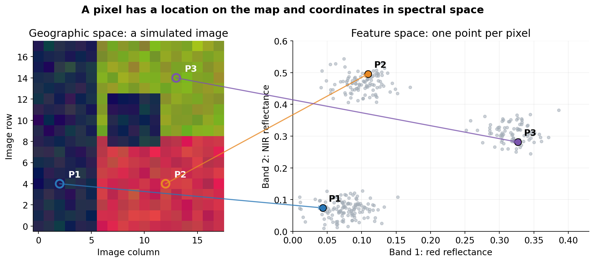
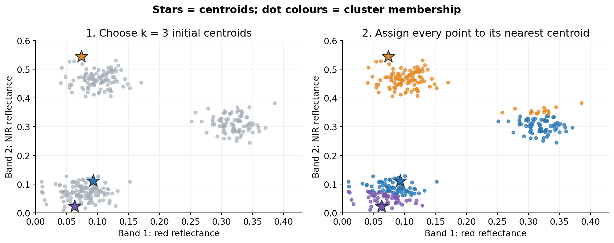
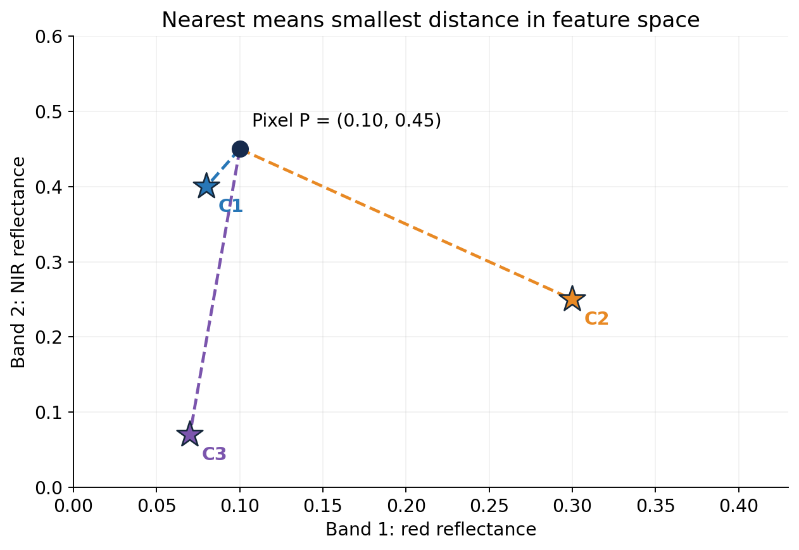
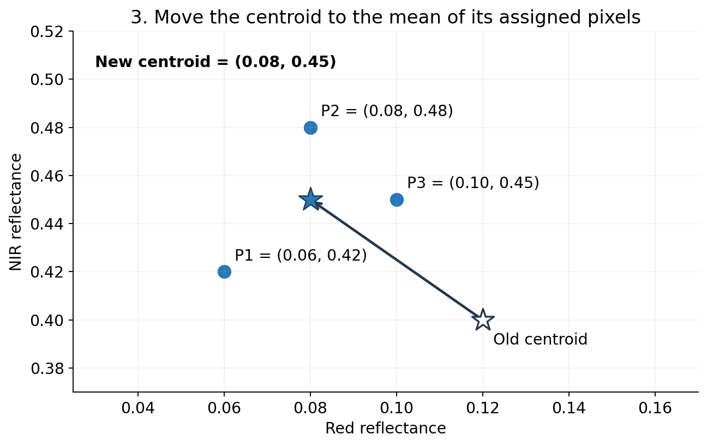
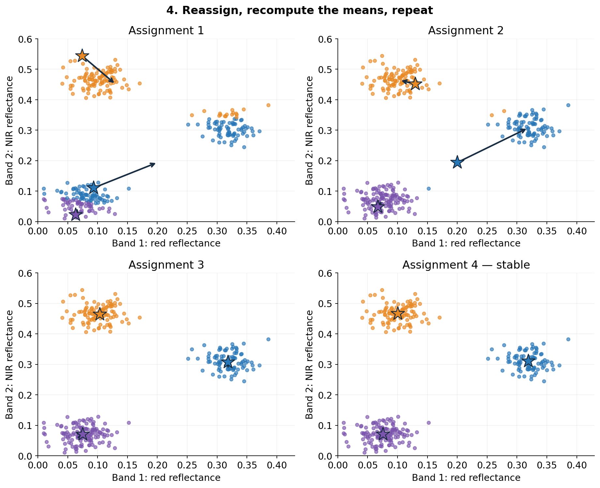
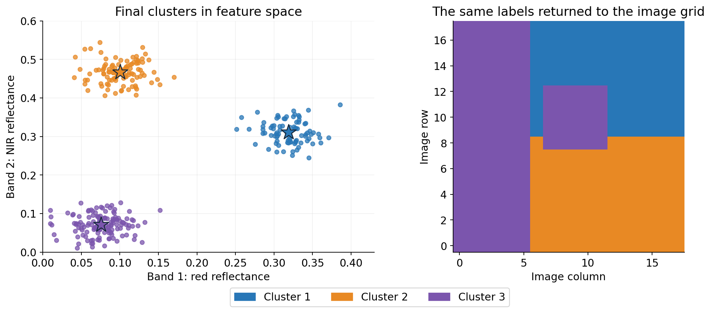
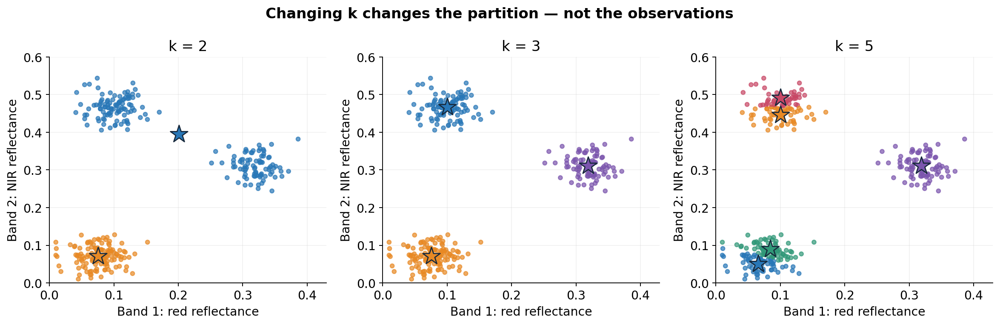

# How k-means classifies a satellite image

## From pixels to groups of similar spectra

A satellite image can be viewed in two different spaces.

In **geographic space**, each pixel occupies a position on the image grid. In **feature space**, the same pixel becomes a point whose coordinates are its values in the selected bands.

For example, if a pixel has red reflectance 0.10 and near-infrared reflectance 0.45, its coordinates in a two-band feature space are **(0.10, 0.45)**.

*Figure 1. The arrows connect the same pixels in geographic space and feature space. The composite image is simulated; it is used to illustrate the relationship between a raster and a cloud of spectral observations.*

Two pixels can be far apart on the map but close together in feature space. This means that their spectral measurements are similar, even though they occur in different places.

**K-means groups points according to their proximity in feature space.** With spectral bands as its inputs, it does not use the geographic distance between pixels.

The plots in this lesson use two bands so that distances can be drawn on a page. The same principle applies to three, ten or more predictors. Principal component scores can also be used as coordinates: the axes would then represent components rather than individual bands. Retaining only some components changes the information and distances available to clustering.

## What do “k” and “means” mean?

**k** is the number of groups requested by the analyst.

**Means** refers to the arithmetic means used to represent those groups. Each group has a **centroid**: a vector containing the mean value of every predictor among the points assigned to that group.

For two bands, the centroid has two coordinates: the group's mean red reflectance and mean NIR reflectance. A centroid is an average spectral position; it need not coincide with an actual pixel.

The aim is to obtain groups whose members lie close to their own centroids.

## Step 1 — Choose k and initialise the centroids

Suppose we choose **k = 3**. The algorithm needs three starting centroids. One simple approach selects three observed points as initial centres.

At this stage, the centres are only starting positions. They do not yet describe the final groups.

*Figure 2. Stars indicate centroids. The left panel shows the initial positions; the right panel shows the first assignment of points to those same centres. This deliberately imperfect start makes the subsequent movement visible.*

Different initial positions can lead to different final partitions. Initialisation strategies such as k-means++ seek more useful starting positions, and multiple starts help explore alternative solutions.

## Step 2 — Assign each pixel to its nearest centroid

For every pixel, calculate its distance to every centroid. Assign it to the nearest one.

For two bands, squared Euclidean distance is:

> d² = (pixel red − centroid red)² + (pixel NIR − centroid NIR)²

For more bands, add one squared difference for each band. Taking the square root gives Euclidean distance, but does not change which centroid is nearest.

*Figure 3. Membership depends on the smallest distance. A pixel is assigned to one cluster even when more than one centroid is relatively close.*

Consider pixel **P = (0.10, 0.45)**:

| Centroid | Coordinates | Squared distance from P |
| --- | --- | ---: |
| C1 | (0.08, 0.40) | 0.0029 |
| C2 | (0.30, 0.25) | 0.0800 |
| C3 | (0.07, 0.07) | 0.1453 |

P is assigned to **cluster 1**, because C1 is nearest.

This decision concerns spectral similarity. It does not yet establish that P represents forest, water or another land-cover class.

## Step 3 — Update each centroid using the mean

Once the points have been assigned, recalculate each centroid as the mean of the points currently belonging to its cluster.

Imagine a cluster containing only these three pixels:

| Pixel | Red reflectance | NIR reflectance |
| --- | ---: | ---: |
| P1 | 0.06 | 0.42 |
| P2 | 0.08 | 0.48 |
| P3 | 0.10 | 0.45 |
| **Mean: new centroid** | **0.08** | **0.45** |

*Figure 4. A separate three-pixel example. The empty star is the old centre; the filled star is the new mean. Average each band separately to obtain the new centroid coordinates.*

Why the mean? For a fixed group of points, its arithmetic mean minimises the sum of squared Euclidean distances to the group's centre. The centroid update therefore improves, or leaves unchanged, that part of the clustering objective.

## Step 4 — Repeat assignment and update

Moving the centroids changes the distances. Some points may now be closer to a different centroid, so assign all points again and recompute the means.

The process alternates between two operations:

1. **Assignment:** keep the centroids fixed and update the memberships.
2. **Update:** keep the memberships fixed and recalculate the centroids.

*Figure 5. Selected snapshots from one run. Stars show the centres used for each assignment; arrows indicate the following update. The final panel shows a stable solution.*

This is the **Lloyd assignment–update algorithm**, a common way to explain and implement k-means. Other algorithms, including Hartigan–Wong, optimise the same clustering criterion through different update procedures.

Stop when memberships no longer change, centroid movement becomes sufficiently small, or an iteration limit is reached. Reaching the iteration limit alone does not demonstrate convergence.

## What is being minimised?

The objective is the **within-cluster sum of squares**, often abbreviated WCSS:

> J = sum, over all pixels, of the squared distance from each pixel to its assigned centroid.

Compact clusters have smaller contributions to J. In the standard Lloyd procedure, assignment and mean updates cannot increase J, apart from numerical effects and implementation details such as handling empty clusters.

However, a stable solution need not be the best possible partition. K-means can converge to a **local optimum**. For a fixed k and the same predictors, multiple starts allow us to retain the solution with the smallest objective among the runs performed.

A small J describes spectral compactness. It does not by itself demonstrate ecological meaning or thematic accuracy.

## Step 5 — Return the cluster labels to the image

Each point originated from a pixel at a known position. Put its cluster ID back into that position to create a categorical raster.

*Figure 6. The point cloud and the map contain exactly the same assignments. Colours represent cluster IDs, not independently verified land-cover labels.*

The algorithm has produced a **spectral partition**. The analyst interprets it by inspecting centroid spectra, spatial patterns and independent reference observations.

One vegetation type may occupy several clusters because of shadow, moisture or phenology. Conversely, different surfaces may share a cluster because their measured spectra overlap. Cluster numbers are arbitrary: cluster 1 has no intrinsic thematic meaning.

## How does the choice of k change the result?

Choosing k determines how many groups the algorithm must construct.

*Figure 7. A smaller k can merge distinct spectral groups; a larger k can split variation within them. Colours and cluster IDs should not be matched between separate runs.*

Increasing k allows a lower or equal best-achievable WCSS. Therefore, minimising WCSS across different k values would favour increasingly fine partitions. An elbow plot or silhouette analysis can help explore candidate values, but neither guarantees a unique, ecologically correct number of classes.

The useful choice depends on the image, the predictors, the scale of variation and the purpose of the classification. The number of spectral clusters need not equal the number of classes in the final map legend.

## Why the predictors and their scales matter

Distance depends on the coordinates supplied to the algorithm.

A predictor with a much larger numerical range can dominate Euclidean distance. Standardisation, or another justified weighting scheme, changes how much each predictor contributes. It therefore changes the meaning of similarity and potentially the resulting map.

Correlated bands can give repeated emphasis to the same spectral variation. Noise, extreme values and unmasked clouds can also influence centroid positions. K-means works most naturally with compact groups under the chosen distance; elongated, overlapping or very unequal groups may be partitioned poorly.

There is no automatic guarantee that a cluster is a real habitat, vegetation type or land-use category. Interpretation and independent assessment are additional steps.

## Questions for discussion

- Can geographically distant pixels belong to the same cluster? Why?
- Why does moving a centroid require another assignment step?
- Can a centroid have coordinates that no observed pixel has?
- If we double the numerical values of one band, can the partition change?
- Why can two runs with the same k produce different results?
- Why does increasing k not necessarily improve a land-cover map?

## Further reading

- [R documentation: k-means clustering](https://stat.ethz.ch/R-manual/R-devel/library/stats/html/kmeans.html), including the objective, alternative algorithms and multiple starting configurations.
- Lloyd, S. P. (1982). Least squares quantization in PCM. *IEEE Transactions on Information Theory*, 28(2), 129–137. [https://doi.org/10.1109/TIT.1982.1056489](https://doi.org/10.1109/TIT.1982.1056489).

*All figures are original teaching diagrams based on simulated reflectance values. No real satellite observations or empirical classification accuracy are represented.*
